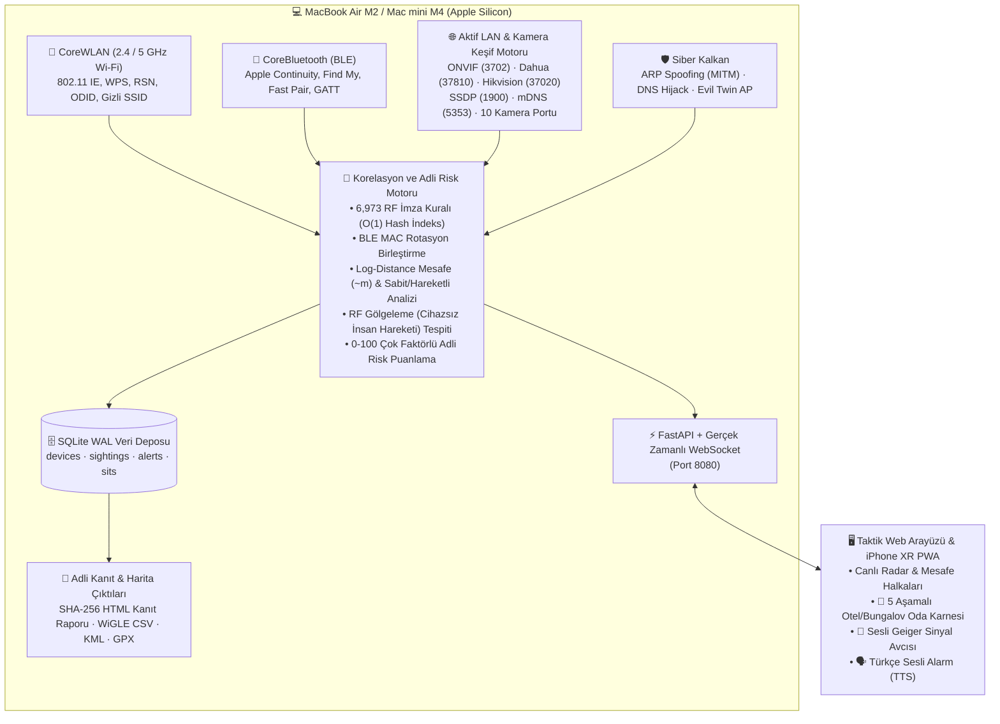

# 🛡️ AirSentinel Core v5 — Taktik RF Karşı-İstihbarat (TSCM), Gizli Kamera Avcısı ve Siber Savunma İstasyonu

-000000?style=for-the-badge&logo=apple)


-38bdf8?style=for-the-badge)


[](https://yucelgumus.dev/)

**AirSentinel Core**, **MacBook Air M2** (taşınabilir saha kiti) ve **Mac mini M4** (sabit üs istasyonu) cihazlarının dahili **CoreWLAN (Wi-Fi)** ve **CoreBluetooth (BLE)** donanımını kullanarak çalışan; **sıfır harici anten/dongle, sıfır bulut bağımlılığı ve %100 yerel gizlilik** ilkesiyle tasarlanmış profesyonel bir **Karşı-İstihbarat (TSCM), Gizli Kamera Tespiti, Ağ Güvenliği (MITM Kalkanı) ve Çevre Koruma** platformudur.

Otel, bungalov, Airbnb konaklamalarında veya ev/ofis ortamında:
1. Ağdaki ve odadaki **gizli kameraları (ONVIF, RTSP, Dahua DHIP, Hikvision SADP, ESP32-CAM, SpyCam SoftAP)** bulur,
2. Bağlandığınız Wi-Fi ağındaki **ARP Spoofing (MITM), DNS Zehirleme (Phishing) ve Sahte Baz İstasyonu (Evil Twin)** saldırılarını yakalar,
3. Çantanıza/aracınıza bırakılan **AirTag, SmartTag, Tile, Chipolo** takip cihazlarını tespit eder,
4. Gece uyurken **Bekçi Modu (Sentry Mode)** ve **RF Sinyal Gölgeleme (Uçak Modundaki / Cihazsız Davetsiz Misafir Hareket Sensörü)** ile odaya yaklaşan kişileri **Türkçe Sesli Anons (TTS)** ile haber verir.

---

## 🏗️ Sistem Mimarisi ve Veri Akışı



---

## 🚀 Öne Çıkan 5 Temel Yetenek Sütunu

### 1. 📹 Gizli Kamera ve Casus Verici Avcısı (Counter-Surveillance / TSCM)
* **Çoklu Kamera Keşif Protokolleri:** Standart port taramasından gizlenen kameraları ortaya çıkarmak için yerel ağa **ONVIF WS-Discovery (`UDP 3702`)**, **Dahua DHIP (`UDP 37810`)**, **Hikvision SADP (`UDP 37020`)**, **UPnP/SSDP (`UDP 1900`)** ve **mDNS/Bonjour (`UDP 5353`)** sorguları gönderir; kameranın marka, model ve fabrika seri numarasını (`SerialNo` / `DeviceSN`) çıkarır.
* **10 Kamera Portu & Banner Okuma:** Yerel ağdaki tüm IP'lerde `554 (RTSP)`, `8554`, `81 (ESP32-CAM MJPEG)`, `8000 (Hikvision)`, `37777 (Dahua)`, `8899 (ONVIF)`, `6668 (Tuya Kamera)`, `1935 (RTMP)`, `8090` ve `80/8080` portlarını yoklar; RTSP `OPTIONS` ve HTTP başlıklarını okur.
* **Casus Kamera Doğrudan Wi-Fi (SpyCam SoftAP) & Oda İçi Gizli SSID Yakalayıcı:** Ağınıza bağlanmadan kendi Wi-Fi yayınını açan priz/ampul/saat tipi gizli kameraları (`V380`, `LookCam`, `HDWiFiCam`, `JXLCAM`, `BVCAM`, `CareCam`, `iCam365`, `HIDVCAM`, `Yoosee` vb.) ve oda içinde güçlü sinyal (`>= -62 dBm`) veren **isimsiz (`<Gizli Wi-Fi Ağı>`)** vericileri yakalar.
* **Donanım Çip Üreticisi (Silicon OUI) İstihbaratı:** Cihaz ismini gizlese bile MAC adresinin ilk 3 baytından içindeki Wi-Fi/BLE yongasını (*Shenzhen Bilian / LB-LINK*, *Espressif ESP32-CAM*, *HiSilicon*, *Hikvision*, *Dahua*, *Tuya*, *Reolink*, *Wyze*, *Aqara*) teşhis eder.

### 2. 🛡️ Ağ Güvenliği ve Siber Saldırı Kalkanı
* **ARP Spoofing / MITM Kalkanı (`ARP_SPOOFING_MITM`):** Bağlı olduğunuz otel veya ev ağında modemin MAC adresi değişirse veya aynı MAC adresi birden fazla IP'de görülürse (Man-in-the-Middle paket dinleme saldırısı) anında `CRITICAL` alarm üretir.
* **DNS Zehirleme ve Sahte Giriş Portalı Kalkanı (`DNS_HIJACK_MITM`):** Ağ geçidi küresel kanarya adreslerini (`www.apple.com`, `one.one.one.one`) gizlice yerel bir sahte IP'ye (`192.168.*`, `10.*`, `172.16-31.*`, `127.*`) yönlendirirse sahte portal / DNS Hijacking alarmı verir.
* **Sahte Baz İstasyonu (`EVIL_TWIN_AP`):** Normalde şifreli (WPA2/WPA3) olan bir Wi-Fi ağının farklı bir BSSID üzerinden şifresiz (Açık) kopyası yayınlandığında Wi-Fi Pineapple / Evil Twin uyarısı verir.
* **Flipper Zero / BLE Spam & BadBLE Klavye Enjeksiyon Analizi:** Bluetooth eşleşme yağmuru saldırılarını (`BLE_PAIRING_FLOOD`), sahte Wi-Fi beacon fırtınalarını (`WIFI_BEACON_FLOOD`) ve GATT `0x1812` **HID Klavye/Fare uzaktan tuş enjeksiyonu** servislerini tespit eder.

### 3. 🚨 Bekçi Modu (Sentry Mode), RF Hareket Sensörü ve Takipçi Tespiti
* **RF Sinyal Gölgeleme ile "Uçak Modundaki / Cihazsız" İnsan Hareketi Tespiti (`RF_PRESENCE_MOTION`):** Bekçi Modu açıkken odadaki sabit referans vericilerin sinyal kararlılığı (`stddev <= 2.5 dB`) izlenir. Üzerinde hiçbir elektronik cihaz taşımayan bir kişi odaya girip RF koridorundan geçtiğinde oluşan ani **$\ge 12\text{ dB}$ sinyal kırılmasını** yakalar.
* **Yakın Mesafe Yabancı Cihaz Alarmı (`INTRUDER_PROXIMITY`) & Türkçe Sesli Anons (TTS):** Gece uyurken güvenli listenizde olmayan bir telefon/cihaz odaya yaklaştığında (`>= -58 dBm`) Mac hoparlöründen Türkçe sesli anonsla uyandırır.
* **Israrcı Takip Cihazı (Stalker) Tespiti (`STALKING_CO_TRAVEL`):** Apple AirTag (`0x1219` Sahibinden Uzak vs. `0x1202` Sahibi Yanında), Samsung SmartTag (`0xFD5A`), Tile (`0xFEED`), Chipolo (`0xFE65`) ve Google Find Hub (`0xFEAA`) etiketlerini ayırt eder.
* **Davranışsal Parmak İzi ile BLE MAC Rotasyonu Birleştirme:** Cihazlar gizlilik için MAC adresini değiştirse bile protokol yükünden aynı cihaz olduğunu anlayarak geçmişini ve güvenli (ev halkı) statüsünü korur.

### 4. 🔬 Derin Protokol Çözümleme, Drone Hava Sahası ve Geiger Sinyal Avcısı
* **802.11 Beacon IE Derin Çözücü:** WPS (`00:50:F2:04`) TLV alanlarından modemin üretici, model ve seri numarasını; RSN (`Tag 48`) verisinden WPA2/WPA3-SAE/Açık şifreleme durumunu ve Wi-Fi 4/5/6 standardını çıkarır.
* **Apple Continuity & AirPlay IP Çıkarıcı:** Apple BLE paketlerinin içindeki `0x09` AirPlay hedefinden cihazın **yerel Wi-Fi IPv4 adresini** (ağ taramasına gerek kalmadan doğrudan havadan) okur.
* **ASTM F3411 Drone Remote ID (`0xFFFA`):** DJI, Autel, Skydio, Parrot droneların seri numarasını (CTA-2063), irtifasını, hızını, uçuş yönünü ve **pilotu yerde durduğu GPS koordinatını** çözer.
* **Sesli Geiger Sinyal Avcısı & Metre Cinsinden Mesafe Tahmini:** Şüpheli bir vericiye kilitlenerek sinyal güçlendikçe hızlanan sesli Geiger sayacı ve Log-Distance Path Loss formülüyle (`~0.2m` .. `50m`) odadaki fiziksel yerini buldurur.

### 5. 🏨 Tek Tıkla 5 Aşamalı Oda Güvenlik Karnesi & SHA-256 Adli Kanıt Raporu
* **Otel / Bungalov Oda Güvenlik Denetimi (`POST /api/audit/room`):** Tek butonla 5 aşamalı tarama yapar ve şüpheli bulunan her cihaz için **Tam Adli İnceleme Dosyası** (neden şüpheli olduğu, tam MAC/UUID, açık portlar, OUI çipi, mesafe, hareketlilik ve tek tıkla Geiger / GATT / Güvenli İşaretle butonları) sunar.
* **SHA-256 Kriptografik Mühürlü Adli Kanıt Raporu (`GET /api/export/forensic-report`):** Tespit edilen gizli kameraları ve saldırı alarmlarını resmi şikayet veya inceleme süreçlerinde kullanılmak üzere **SHA-256 bütünlük özetli** tek dosyalık Türkçe HTML kanıt raporu olarak indirir.

---

## ⚡ Hızlı Kurulum ve Çalıştırma (MacBook Air M2 & Mac mini M4)

Projeyi yeni bir MacBook Air M2'ye indirdiğinizde sanal ortam (`.venv`) ve tüm Apple Silicon (`pyobjc-framework-CoreWLAN`, `bleak`, `fastapi`) bağımlılıkları **`./start.sh` tarafından otomatik kurulur**:

```bash
# 1. Repoyu klonlayın
git clone https://github.com/yucel-gumus/airsentinel.git
cd airsentinel

# 2. Tek komutla başlatın (İlk çalışmada .venv ve paketleri otomatik kurar)
./start.sh
```

Tarayıcınızda otomatik olarak veya doğrudan şu adresten açın:
* **Mac Ekranı:** `http://127.0.0.1:8080`
* **iPhone XR / Mobil (Aynı Wi-Fi veya iPhone Kişisel Erişim Noktası):** Terminalde yazan `http://<MAC_IP_ADRESI>:8080` adresini Safari'de açıp **Paylaş $\rightarrow$ Ana Ekrana Ekle** diyerek tam ekran mobil radar olarak kullanabilirsiniz.

---

## 🧳 Otel / Bungalov Saha Kullanım Rehberi (Adım Adım)

1. **Odaya İlk Girişte:** MacBook Air M2'nizi odaya koyun, `./start.sh` komutunu çalıştırın ve üst menüdeki mavi **`🏨 Oda Güvenlik Denetimi`** butonuna basın.
2. **Şüpheli Cihaz Çıkarsa:** Karne ekranındaki **Tam Adli İnceleme Dosyası** kartından cihazın neden işaretlendiğini okuyun:
   * Kendi telefonunuz veya bilgisayarınızsa **`🏠 Benim Cihazım (Güvenli İşaretle)`** butonuna basın.
   * Tanımadığınız sabit (`📌`) bir verici veya kamera ise **`🎯 Geiger Sayacı ile Odada Yerini Bul`** butonuna basıp MacBook ile odada (TV ünitesi, prizler, duman dedektörü, yatak başlığı) dolaşarak sinyalin `-35 dBm` (`< 1m`) olduğu noktayı bulun.
3. **Kanıt Kaydı Almak İçin:** Denetim penceresinin sağ altındaki **`📄 Adli Kanıt Raporu İndir (SHA-256 Mühürlü)`** butonuna basarak resmi HTML kanıt dosyasını kaydedin.
4. **Gece Uyurken veya Odadan Çıkarken:**
   * Üst menüden **`🏠 Evdekileri Güvenli Kaydet`** $\rightarrow$ **`🛡️ Bekçi Modu`** $\rightarrow$ **`🗣️ Sesli Anons: AÇIK`** adımlarını etkinleştirin.
   * Odadan dışarı çıkarken **`4. Ortam Karşılaştırma`** sekmesinden *"Odadan Çıkarken"* kaydı alın; döndüğünüzde ikinci kaydı alarak siz yokken odaya giren cihazları görün.

---

## 🧪 Test Paketi ve Doğrulama

Tüm protokol çözücüler, kamera keşif motorları, ARP/DNS MITM kalkanları, RF gölgeleme hareket dedektörü ve API uç noktaları 48 birim ve entegrasyon testiyle doğrulanmıştır:

```bash
.venv/bin/pytest -v
```

---

## 📁 Proje Dizin Yapısı

```text
airsentinel/
├── airsentinel/
│   ├── config.py                  # Çalışma zamanı ve zaman aşımı ayarları
│   ├── models.py                  # Pydantic veri ve tehdit modelleri
│   ├── scanners/
│   │   ├── ble_scanner.py         # CoreBluetooth BLE tarayıcı & GATT güvenlik analizi
│   │   └── wifi_scanner.py        # CoreWLAN 802.11 IE, ONVIF/Dahua/Hikvision, ARP & DNS kalkanı
│   ├── signatures/
│   │   ├── catalog.py             # 6,973 kural O(1) imza eşleştirme motoru
│   │   ├── decoder.py             # Apple Continuity, Find My, Fast Pair, MiBeacon, SwitchBot çözücü
│   │   ├── remote_id.py           # ASTM F3411 Drone Remote ID & CTA-2063 çözücü
│   │   └── rules_catalog.json     # Derlenmiş RF imza veri tabanı (v94)
│   ├── correlation/
│   │   ├── engine.py              # Merkezi korelasyon, MITM, Evil Twin ve RF hareket motoru
│   │   ├── flood_detector.py      # BLE eşleşme yağmuru & Wi-Fi beacon fırtınası dedektörü
│   │   ├── tracker_detector.py    # AirTag / SmartTag / Tile takipçi (co-travel) analizi
│   │   └── hunt.py                # Geiger Sinyal Avcısı canlı RSSI telemetri motoru
│   ├── storage/
│   │   └── db.py                  # SQLite WAL, MAC rotasyon birleştirme, mesafe & risk motoru
│   ├── intel/
│   │   ├── ai_analyzer.py         # Türkçe durum özeti (SIT-REP) ve yerel Ollama entegrasyonu
│   │   └── exporters.py           # SHA-256 Adli Kanıt HTML, WiGLE CSV, KML ve GPX dışa aktarıcı
│   └── web/
│       ├── app.py                 # FastAPI REST & WebSocket sunucusu + 5 aşamalı oda denetimi
│       └── static/                # Taktik Türkçe Web/PWA arayüzü (index.html, app.js, style.css)
├── tests/                         # 48 kapsamlı test paketi (v1..v5)
├── start.sh                       # Otomatik kurulumlu (self-bootstrapping) taşınabilir başlatıcı
├── run.py                         # Uvicorn / FastAPI giriş noktası
├── LICENSE                        # MIT Açık Kaynak Lisansı
└── requirements.txt               # Python bağımlılıkları
```

---

## 👨‍💻 Geliştirici & İletişim

* **Geliştirici:** **Yücel Gümüş** (*Software Developer*)
* **Web Sitesi:** [https://yucelgumus.dev/](https://yucelgumus.dev/)
* **GitHub:** [@yucel-gumus](https://github.com/yucel-gumus)

---

## 📜 Lisans

Bu proje **MIT Lisansı** altında açık kaynak olarak sunulmaktadır. Ayrıntılar için [`LICENSE`](LICENSE) dosyasına bakabilirsiniz.

